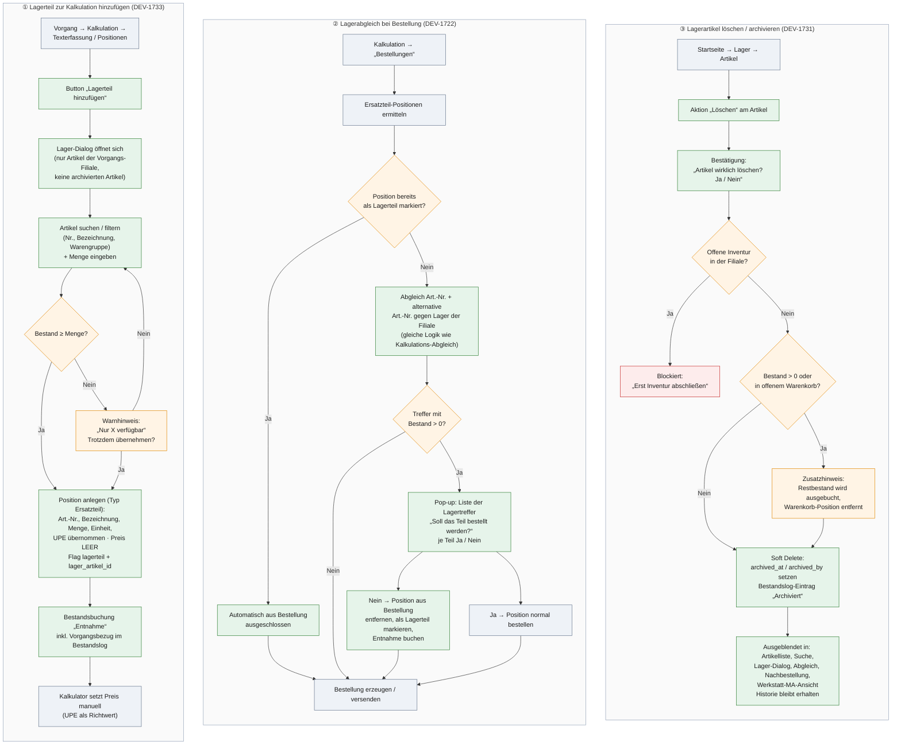

# Lagermodul – Developer Briefing

**Epic:** [DEV-1722](https://pdr-cloud.atlassian.net/browse/DEV-1722) · **Idee:** [PCD-162](https://pdr-cloud.atlassian.net/browse/PCD-162) · **Design:** [UIX-50](https://pdr-cloud.atlassian.net/browse/UIX-50)
**Stand:** 17.11.2026 · **Autor:** Tobias Brinster (Product) · **Status:** Bereit für Refinement

> **Ziel:** Das Lagermodul in der Haupt-App soll im Werkstattalltag tatsächlich genutzt werden – für Verbrauchsmaterial, Kleinteile und wiederverwendbare Rest-/Gebrauchtteile (z. B. angeschnittene Seitenwände). Dieses Dokument beantwortet die offenen Fragen vorab, damit die Umsetzung ohne Rückfragen starten kann. Wo eine Entscheidung noch formal bestätigt werden muss, steht ein **Vorschlag (Default)**, mit dem du arbeiten kannst.

---

## 1. Scope auf einen Blick

| # | Feature | Ticket | Aufwand (Schätzung) | Priorität |
|---|---------|--------|---------------------|-----------|
| 1 | Lagerteil per Button zur Kalkulation hinzufügen (inkl. UPE-Übernahme) | [DEV-1733](https://pdr-cloud.atlassian.net/browse/DEV-1733) | M–L | 1 |
| 2 | Lagerabgleich auch beim Bestellen (Pop-up „Teil bestellen? Ja/Nein“) | [DEV-1722](https://pdr-cloud.atlassian.net/browse/DEV-1722) (Story fehlt noch) | M | 2 |
| 3 | Lagerartikel löschen/archivieren | [DEV-1731](https://pdr-cloud.atlassian.net/browse/DEV-1731) | S–M | 1 |
| 4 | Wording/Erklärung „Gebindegröße“ | [DEV-1732](https://pdr-cloud.atlassian.net/browse/DEV-1732) | XS | 3 |

**Nicht im Scope:** Räderlager-Lagerort ändern ([DEV-1825](https://pdr-cloud.atlassian.net/browse/DEV-1825) – anderes Modul), Inventur-Logik, Labeldruck, Lieferanten-Schnittstellen.
**Eng verwandt (bitte mitprüfen):** [DEV-1708](https://pdr-cloud.atlassian.net/browse/DEV-1708) – Filial-Zuordnung von Lagerorten greift nicht. Der neue Lager-Dialog (Feature 1) und der Bestell-Abgleich (Feature 2) filtern nach Filiale; wenn der Filialfilter grundsätzlich defekt ist, betrifft das beide Features.

---

## 2. Ist-Zustand (heute)

Quelle: Confluence „PDR.cloud – Lagermodul“ (Support-Doku, A. Meller).

| Bereich | Pfad | Funktion heute |
|---------|------|----------------|
| Einstellungen | Einstellungen → Lager | Warengruppen, Preisgruppen (VK per Aufschlag) |
| Lager-Hauptansicht | Startseite → Lager | Artikel anlegen/bearbeiten, Warenkorb pro Lieferant, Nachbestellung auf Mindestbestand, Inventur, Bestandslog, manuelle Bestandsbuchung |
| Kalkulation | Vorgang → Kalkulation → Texterf./Positionen → **Lager-Button** | **Abgleich** vorhandener Kalkulationspositionen mit Lagerbestand, Kennzeichnung als Lagerteil, Entnahme + Bestandsreduktion |
| Werkstatt-MA | Werkstatt-Mitarbeiter-Ansicht | Entnahme von Verbrauchsmaterial auf Vorgang (Suche oder QR-Scan) |

**Artikel-Stammdaten heute:** Artikelnummer, Einheit (ST/L/KG/M), Art (OEM/OE/IAS/Gebraucht), Warengruppe, Flag „Verbrauchsmaterial“, Hersteller/Modell, EAN, Bezeichnung, Bild, EK, UPE (optional, pro Einheit), VK (fest oder Aufschlag auf UPE), Filialzuordnung, Mindestbestand + Lagerort (pro Filiale), Lieferant, alternative Artikelnummern, Gebindegröße.

**Probleme laut Kunden/CS:**

1. Artikel lassen sich weder löschen noch archivieren → Liste wächst über Jahre, wird unübersichtlich („Lagerleichen“).
2. Lagerabgleich gibt es nur in der Kalkulation, nicht beim Bestellen → Teile werden bestellt, obwohl sie auf Lager liegen.
3. Um ein Lagerteil in eine (freie) Kalkulation zu bekommen, muss es zusätzlich als **Arbeitstext-Vorlage** gepflegt werden → doppelte Pflege, wird deshalb kaum genutzt.
4. „Gebindegröße“ wird von Kunden nicht verstanden.

---

## 3. Glossar (Fachbegriffe)

| Begriff | Bedeutung |
|---------|-----------|
| **Vorgang** | Ein Werkstattauftrag/Schadenfall in PDR.cloud. Hat genau eine Filiale. |
| **Kalkulation** | Kostenaufstellung im Vorgang. Kann aus DAT/Audatex (AX) importiert oder frei in PDR erstellt werden („freie Kalkulation“). |
| **Texterfassung / Positionen** | Bereich der Kalkulation, in dem manuelle Positionen (Arbeit, Ersatzteil, Material) angelegt werden. |
| **Lagerteil** | Kalkulationsposition, die aus dem eigenen Lager bedient wird (nicht bestellt). |
| **Lagerabgleich** | Vergleich der Ersatzteilpositionen (Art.-Nr. + alternative Art.-Nr.) mit dem Lagerbestand. |
| **UPE** | Unverbindliche Preisempfehlung des Herstellers – Basis für den Verkaufspreis. |
| **EK** | Einkaufspreis der Werkstatt – für die Kalkulation meist nicht relevant. |
| **VK / Preis** | Preis, der in der Kalkulation tatsächlich berechnet wird. |
| **Gebindegröße** | Anzahl Einheiten pro Bestelleinheit (Verpackungseinheit). Beispiel: 12 = ein Karton mit 12 Flaschen. |
| **Verbrauchsmaterial** | Artikel, die Werkstatt-MA selbst auf einen Vorgang ausbuchen dürfen (Clips, Reiniger, Betriebsstoffe). |
| **Inventur** | Abgleich des Systembestands mit dem tatsächlichen Bestand. Solange eine Inventur offen ist, darf sich der Bestand nicht ändern. |

---

## 4. Prozessflow

Gerendert: [`../diagrams/lagermodul_prozessflow.png`](../diagrams/lagermodul_prozessflow.png) / [`.svg`](../diagrams/lagermodul_prozessflow.svg). Grün = neu, grau = existiert schon, orange = Entscheidung/Hinweis, rot = blockiert.



---

## 5. Feature-Spezifikationen

### Feature 1 – Lagerteil zur Kalkulation hinzufügen ([DEV-1733](https://pdr-cloud.atlassian.net/browse/DEV-1733))

**User Story:** Als Kalkulator möchte ich ein Teil direkt aus dem Lager in die Kalkulation übernehmen, damit ich keine Arbeitstext-Vorlage doppelt pflegen muss.

**Ist:** Lagerteile kommen nur über eine zusätzlich gepflegte Arbeitstext-Vorlage in die Kalkulation. Der vorhandene Lager-Button gleicht nur *bestehende* Positionen ab.

**Soll:**

1. In **Texterfassung / Positionen** gibt es einen neuen Button **„Lagerteil hinzufügen“** neben den bestehenden Aktionen (Design: UIX-50).
2. Klick öffnet einen **Lager-Dialog** (Modal), der die Artikelsuche der Lager-Hauptansicht wiederverwendet:
   - Suche nach Artikelnummer, alternativer Artikelnummer, Bezeichnung, EAN
   - Filter nach Warengruppe
   - Spalten: Art.-Nr., Bezeichnung, Einheit, verfügbarer Bestand (Filiale des Vorgangs), UPE, Lagerort
   - Nur Artikel der **Filiale des Vorgangs** (bzw. ohne Filialzuordnung) und **keine archivierten** Artikel
3. Nutzer wählt **einen oder mehrere** Artikel und gibt je Artikel eine **Menge** ein (Default 1, Dezimal erlaubt bei L/KG/M).
4. Bei **Bestand < Menge**: Warnhinweis „Nur X {Einheit} verfügbar. Trotzdem übernehmen?“ – Übernahme ist erlaubt (Bestand darf negativ werden, siehe Entscheidung E3).
5. Pro Artikel wird eine **Ersatzteil-Position** angelegt:

| Kalkulationsfeld | Wert |
|------------------|------|
| Typ | Ersatzteil |
| Teilenummer | Lager-Artikelnummer |
| Bezeichnung | Lager-Artikelbezeichnung |
| Menge | eingegebene Menge |
| Einheit | Lager-Einheit |
| **UPE** | **UPE aus dem Lagerartikel** (pro Einheit) |
| EK | EK aus dem Lagerartikel (falls Feld vorhanden; nur informativ) |
| **Preis** | **leer** – wird vom Kalkulator manuell gesetzt |
| Lager-Kennzeichen | wie beim bestehenden Abgleich (Position = Lagerteil) |
| Referenz | `lager_artikel_id` (neu, falls nicht vorhanden) |

6. Es wird eine **Entnahme** gebucht (gleiches Verhalten wie der bestehende Abgleich), Bestandslog-Eintrag mit Vorgangsbezug.
7. Wird die Position später **gelöscht** oder die **Menge geändert**, wird die Bestandsbuchung entsprechend **korrigiert** (Rückbuchung/Differenzbuchung mit Log-Eintrag).

**Akzeptanzkriterien:**

- [ ] Button ist sichtbar in Texterfassung/Positionen, wenn das Lagermodul für den Account aktiv ist; sonst nicht sichtbar.
- [ ] Dialog zeigt nur Artikel der Vorgangs-Filiale + Artikel ohne Filialzuordnung, keine archivierten.
- [ ] Nach Übernahme: Position mit UPE befüllt, Preisfeld leer, als Lagerteil gekennzeichnet.
- [ ] Bestand reduziert sich um die Menge; Bestandslog zeigt „Entnahme – Vorgang {Nr.}“.
- [ ] Position löschen → Bestand wird zurückgebucht, Log-Eintrag „Rückbuchung – Vorgang {Nr.}“.
- [ ] Artikel ohne UPE → UPE-Feld bleibt leer, kein Fehler.
- [ ] Funktioniert in freier Kalkulation **und** in importierten DAT/AX-Kalkulationen (als manuelle Zusatzposition; kein Rückschreiben an DAT/AX).

---

### Feature 2 – Lagerabgleich bei Bestellung ([DEV-1722](https://pdr-cloud.atlassian.net/browse/DEV-1722))

**User Story:** Als Teiledienst/Serviceberater möchte ich beim Bestellen sehen, welche Teile bereits auf Lager liegen, damit ich keine unnötigen Bestellungen auslöse.

**Ist:** Das Pop-up „Teil auf Lager“ erscheint nur beim Abgleich in der Kalkulationsübersicht. Wer direkt über „Bestellungen“ geht, bestellt auch Teile, die vorhanden sind.

**Soll:**

1. Klick auf **„Bestellungen“** aus der Kalkulation startet vor dem Erzeugen der Bestellung den Abgleich.
2. Positionen, die **bereits als Lagerteil gekennzeichnet** sind (über Feature 1 oder den bestehenden Abgleich), werden **automatisch nicht bestellt** und erscheinen nicht im Pop-up.
3. Für alle übrigen Ersatzteil-Positionen: Abgleich Teilenummer gegen Artikelnummer **und** alternative Artikelnummern im Lager der Vorgangs-Filiale. **Die vorhandene Abgleichslogik der Kalkulation wiederverwenden**, nicht neu bauen.
4. Bei Treffern mit Bestand > 0: **Pop-up** (gleiches Layout wie das bestehende Abgleich-Pop-up) mit Liste der Treffer: Teilenummer, Bezeichnung, benötigte Menge, Lagerbestand, Lagerort. Frage je Teil: **„Soll das Teil bestellt werden? Ja / Nein“**. Default = **Nein** (nicht bestellen, weil auf Lager).
5. **Nein** → Position wird aus der Bestellung entfernt, als Lagerteil gekennzeichnet, Entnahme gebucht (identisch zu Feature 1, Punkt 6).
6. **Ja** → Position wird normal bestellt, keine Bestandsänderung.
7. Ohne Treffer → kein Pop-up, Bestellung läuft wie heute.

**Akzeptanzkriterien:**

- [ ] Pop-up erscheint nur bei Treffern mit Bestand > 0.
- [ ] Bereits gekennzeichnete Lagerteile tauchen weder im Pop-up noch in der Bestellung auf.
- [ ] Treffer über alternative Artikelnummer werden erkannt.
- [ ] „Nein“ reduziert den Bestand und schreibt einen Log-Eintrag mit Vorgangsbezug.
- [ ] Abbrechen des Pop-ups bricht die Bestellung ab (keine Teilbestellung, keine Bestandsänderung).
- [ ] Teilbestand (benötigt 2, Lager 1): siehe Entscheidung E4.

---

### Feature 3 – Lagerartikel löschen / archivieren ([DEV-1731](https://pdr-cloud.atlassian.net/browse/DEV-1731))

**User Story:** Als Lagerverantwortlicher möchte ich nicht mehr genutzte Artikel entfernen, damit die Liste übersichtlich bleibt.

**Soll:**

1. In der Artikelliste (Startseite → Lager → Artikel) gibt es pro Artikel die Aktion **„Löschen“** (Papierkorb-Icon im Aktionsmenü, siehe UIX-50).
2. Bestätigungsdialog: **„Möchten Sie den Artikel {Art.-Nr. – Bezeichnung} wirklich löschen? Ja / Nein“**
3. Technisch: **Soft Delete / Archivierung** (`archived_at`, `archived_by`), **kein Hard Delete**. Grund: Der Artikel ist über Bestandslog, Kalkulationspositionen, Bestellungen und Rechnungen referenziert; diese Historie muss erhalten bleiben. Das entspricht gängiger Praxis bei Werkstatt- und Inventarsoftware (Soft Delete bei Referenzen, Sperre während offener Inventur).
4. **Prüfungen vor dem Löschen:**

| Bedingung | Verhalten |
|-----------|-----------|
| Offene Inventur in einer Filiale, in der der Artikel geführt wird | **Blockiert**: „Der Artikel ist Teil einer offenen Inventur. Bitte schließen Sie die Inventur zuerst ab.“ |
| Bestand > 0 | Zusatzhinweis im Dialog: „Es sind noch X {Einheit} auf Lager. Der Bestand wird beim Löschen ausgebucht.“ → Ausbuchung mit Log-Eintrag „Archivierung“ |
| Artikel liegt in einem offenen Warenkorb | Zusatzhinweis; Warenkorb-Position wird entfernt |
| Artikel in bereits versendeter Bestellung | Kein Einfluss; Bestellung bleibt unverändert |

5. **Archivierte Artikel werden ausgeblendet in:** Artikelliste (Default), Suche, Lager-Dialog (Feature 1), Abgleich Kalkulation + Bestellung (Feature 2), Nachbestellung, Werkstatt-MA-Ansicht/QR-Scan.
6. **Sichtbar bleiben:** bestehende Kalkulationspositionen, Bestellungen, Rechnungen, Bestandslog.
7. **Filter „Archivierte anzeigen“** in der Artikelliste + Aktion **„Wiederherstellen“** (Bestand startet bei 0).
8. Neuanlage mit derselben Artikelnummer wie ein archivierter Artikel ist erlaubt (Unique-Constraint, falls vorhanden, auf aktive Artikel beschränken) – siehe E6.

**Akzeptanzkriterien:**

- [ ] Löschen nur mit Bestätigung.
- [ ] Archivierter Artikel erscheint in keiner Auswahl/Suche/Nachbestellung mehr.
- [ ] Historische Belege mit dem Artikel bleiben vollständig lesbar.
- [ ] Während offener Inventur ist Löschen blockiert.
- [ ] Wiederherstellen macht den Artikel wieder normal verfügbar.
- [ ] Berechtigung: gleiche Rolle wie „Artikel bearbeiten“.

---

### Feature 4 – Wording „Gebindegröße“ ([DEV-1732](https://pdr-cloud.atlassian.net/browse/DEV-1732))

**Soll:** Info-Icon (ⓘ) mit Tooltip neben dem Feld „Gebindegröße“ in „Neuer Artikel“ / „Artikel bearbeiten“, zusätzlich eine Hilfezeile unter dem Feld.

**Feldlabel:** `Gebindegröße (Stück pro Bestellung)`

**Tooltip-Text (final):**
> Anzahl der Einheiten, die Sie mit **einer** Bestellung dieses Artikels erhalten.
> Beispiel: Gebindegröße **12** und Einheit **ST** → Sie bestellen 1 Karton und erhalten **12 Flaschen** Reiniger. Ihr Lagerbestand erhöht sich beim Wareneingang um 12.

**Platzhalter im Feld:** `z. B. 12`

**Bitte im Code prüfen:** Wird die Gebindegröße beim Wareneingang/in der Nachbestellung heute schon multipliziert (1 Bestellung = 12 Bestand)? Der Tooltip muss zum tatsächlichen Verhalten passen. Wenn **nicht** multipliziert wird, bitte als Befund im Ticket melden; dann passen wir den letzten Satz des Tooltips an, statt die Logik in diesem Ticket zu ändern.

---

## 6. Datenmodell – Vorschlag

> Die tatsächlichen Tabellen- und Feldnamen kenne ich nicht. Bitte auf die bestehenden Strukturen mappen; neue Felder nur dort, wo nichts Passendes existiert.

```text
lager_artikel
  + archived_at        TIMESTAMP NULL      -- Soft Delete
  + archived_by        USER_ID   NULL
  (Unique Art.-Nr. nur WHERE archived_at IS NULL)

kalkulation_position
  + lager_artikel_id   FK NULL            -- Referenz auf Lagerartikel
    ist_lagerteil      BOOL               -- vermutlich vorhanden (bestehender Abgleich)

bestandslog
    typ                ENUM  + 'RUECKBUCHUNG', 'ARCHIVIERUNG'
    vorgang_id         FK NULL            -- vermutlich vorhanden
```

Alle Abfragen für Auswahl, Suche, Abgleich, Nachbestellung und Werkstatt-MA brauchen den Filter `archived_at IS NULL`. Am besten zentral als Default-Scope oder Repository-Filter umsetzen, nicht an jeder Stelle einzeln.

---

## 7. Entscheidungen

Mit diesen Defaults kannst du arbeiten. Product bestätigt sie im Refinement; ändert sich etwas, wird es hier aktualisiert.

| # | Frage | Entscheidung (Default) | Begründung |
|---|-------|------------------------|------------|
| E1 | Löschen = Hard oder Soft Delete? | **Soft Delete** (Archivierung). In der UI heißt die Aktion „Löschen“. | Referenzen in Belegen/Log, Wiederherstellbarkeit |
| E2 | Wann wird Bestand bei Feature 1 reduziert? | **Sofort beim Übernehmen** in die Kalkulation; Rückbuchung beim Löschen/Ändern der Position | Konsistent zum bestehenden Abgleich |
| E3 | Darf Bestand negativ werden? | **Ja, mit Warnhinweis** | Werkstattrealität: Bestand oft ungenau; kein harter Stopp im Kalkulationsfluss |
| E4 | Teilbestand bei Bestellung (benötigt 2, Lager 1)? | **Version 1:** Pop-up zeigt „Lager: 1 / benötigt: 2“. „Nein“ = komplette Position aus Lager (Bestand wird negativ), „Ja“ = komplette Position bestellen. **Kein** automatisches Aufteilen. | Klein halten; Aufteilen ggf. später als eigenes Ticket |
| E5 | Preis bei Übernahme aus dem Lager? | **UPE übernehmen, Preis leer** (so im Ticket gewünscht). Ein im Lager hinterlegter VK wird in V1 **nicht** übernommen. | Kalkulator entscheidet den Preis |
| E6 | Gleiche Art.-Nr. nach Archivierung neu anlegen? | **Erlaubt** | Typischer Fall: Artikel versehentlich gelöscht oder neu gelistet |
| E7 | Wer darf löschen? | Gleiche Berechtigung wie „Artikel bearbeiten“ | Keine neue Rolle nötig |
| E8 | Filialen ohne Filialfunktion? | Filter entfällt; alle aktiven Artikel sichtbar | Abwärtskompatibel |
| E9 | DAT/AX-importierte Kalkulation? | Button verfügbar; Lagerteil wird als manuelle PDR-Position ergänzt, nicht an DAT/AX zurückgeschrieben | Kein Eingriff in Schnittstellen |
| E10 | Mehrfachauswahl im Lager-Dialog? | **Ja** | Typisch: mehrere Kleinteile/Clips auf einmal |

---

## 8. Abhängigkeiten & Risiken

- **DEV-1708 (Filialfilter Lagerort):** Wenn die Filialzuordnung grundsätzlich nicht greift, zeigen der neue Dialog und der Bestell-Abgleich Artikel anderer Filialen. → Vor Feature 1/2 klären, ob DEV-1708 nur den Wareneingang betrifft oder die Filiallogik allgemein.
- **Offene Inventur:** Laut Doku führen Bestandsänderungen während einer offenen Inventur zu Fehlern. Bei Feature 1/2 (Entnahme) mindestens **Warnhinweis** anzeigen, wenn für die Filiale eine Inventur offen ist. Sperren ist nicht nötig, das würde den Werkstattbetrieb blockieren.
- **Doppelbuchung:** Wird eine Position erst über Feature 1 hinzugefügt und dann zusätzlich über den alten Abgleich-Button abgeglichen, darf nicht doppelt entnommen werden. → `ist_lagerteil = true` muss den Abgleich überspringen.
- **Abgleichslogik zentralisieren:** Kalkulations-Abgleich und Bestell-Abgleich nutzen dieselbe Funktion (Art.-Nr. + alternative Nr., Filiale, nicht archiviert).

---

## 9. Testfälle (Definition of Done)

| # | Szenario | Erwartung |
|---|----------|-----------|
| T1 | Lagerteil (Bestand 5) mit Menge 2 in freie Kalkulation übernehmen | Position mit UPE, Preis leer; Bestand 3; Log „Entnahme – Vorgang X“ |
| T2 | Position aus T1 löschen | Bestand 5; Log „Rückbuchung“ |
| T3 | Menge in T1 von 2 auf 3 ändern | Bestand 2; Differenzbuchung |
| T4 | Menge 4 bei Bestand 1 | Warnhinweis; nach Bestätigung Bestand −3 |
| T5 | Bestellung aus Kalkulation mit 1 Lagertreffer → „Nein“ | Teil nicht in Bestellung; als Lagerteil markiert; Bestand reduziert |
| T6 | Bestellung mit Treffer über alternative Art.-Nr. | Treffer im Pop-up |
| T7 | Bestellung mit bereits markiertem Lagerteil | Kein Pop-up für dieses Teil; nicht bestellt |
| T8 | Pop-up abbrechen | Keine Bestellung, keine Bestandsänderung |
| T9 | Artikel mit Bestand 0 löschen | Archiviert, aus allen Listen verschwunden, Historie sichtbar |
| T10 | Artikel mit Bestand 3 löschen | Hinweis, Ausbuchung, Log „Archivierung“ |
| T11 | Artikel löschen bei offener Inventur | Blockiert mit Meldung |
| T12 | Archivierten Artikel wiederherstellen | Wieder auswählbar, Bestand 0 |
| T13 | Filiale A: Artikel nur Filiale B | Nicht im Dialog/Abgleich (abhängig von DEV-1708) |
| T14 | Tooltip Gebindegröße | Text wie in Abschnitt 5, Feature 4 |
| T15 | Lagermodul für Account deaktiviert | Kein Button, kein Pop-up |

---

## 10. Quellen

**Intern**

- [PCD-162 – Idee (Basis)](https://pdr-cloud.atlassian.net/browse/PCD-162)
- [DEV-1722 – Epic](https://pdr-cloud.atlassian.net/browse/DEV-1722) · [DEV-1731](https://pdr-cloud.atlassian.net/browse/DEV-1731) · [DEV-1732](https://pdr-cloud.atlassian.net/browse/DEV-1732) · [DEV-1733](https://pdr-cloud.atlassian.net/browse/DEV-1733) · [UIX-50](https://pdr-cloud.atlassian.net/browse/UIX-50)
- [DEV-1708 – Filialfilter Lagerort](https://pdr-cloud.atlassian.net/browse/DEV-1708) · [DEV-1825 – Räderlager](https://pdr-cloud.atlassian.net/browse/DEV-1825) · [SUP-733 – K&L-Nutzung](https://pdr-cloud.atlassian.net/browse/SUP-733)
- [Confluence: PDR.cloud – Lagermodul (Support-Doku)](https://pdr-cloud.atlassian.net/wiki/spaces/Support/pages/1277558785/PDR.cloud+-+Lagermodul)

**Extern (Best Practice)**

- [Workshop Software – Product deletion & soft delete logic](https://knowledgebase.workshopsoftware.com/how-product-deletion-and-soft-delete-logic-works) – Soft Delete bei Referenzen, Sperre während Inventur
- [IF4IT – Retire inventory entries properly: mark as inactive before removing](https://if4it.org/best-practices/enterprise-inventory-management/retire-inventory-entries-properly-mark-as-inactive-before-removing/)
- [Reftab – When to archive vs. delete assets](https://www.reftab.com/blog/when-to-archive-vs-delete-assets-itam-best-practices)
- [AppMaster – Soft delete vs hard delete](https://appmaster.io/blog/soft-delete-vs-hard-delete)
- [AUTOHAUS – Lagerleichen ade](https://www.autohaus.de/nachrichten/autohandel/lagerleichen-ade-1270878) – Problem nicht abgeholter/ungenutzter Teile im Werkstattlager
- [tacto – Gebindegrößen (Einkäufer-Lexikon)](https://www.tacto.ai/de/einkaufer-lexikon/gebindegroessen)
