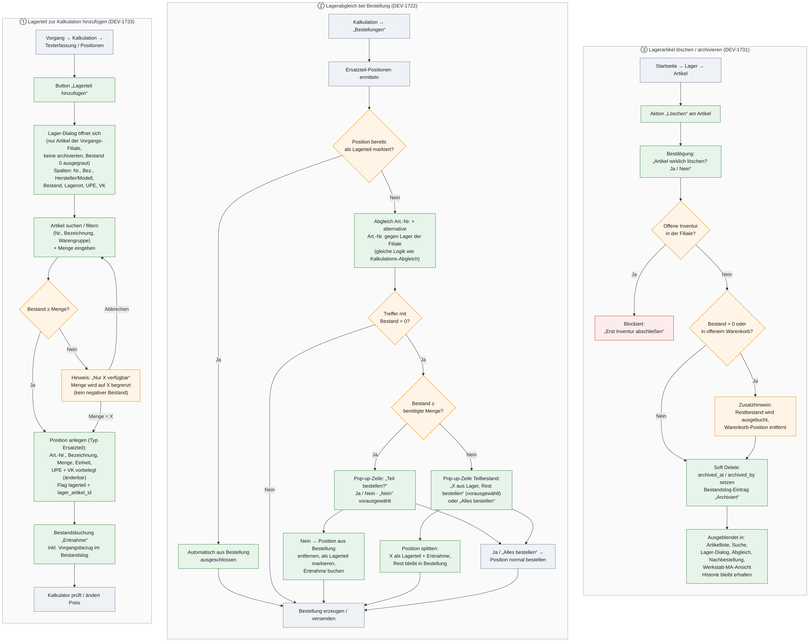

# Enhancements to the Lager Modul for comprehensive use

Ziel ist es, das aktuelle Lagermodul in der Main App von PDR.cloud zu verbessern und für den Markt nutzbar zu machen.

**Basis:** [PCD-162](https://pdr-cloud.atlassian.net/browse/PCD-162) · **Epic:** [DEV-1722](https://pdr-cloud.atlassian.net/browse/DEV-1722)

## Inhalt

| Datei | Beschreibung |
|-------|--------------|
| [`docs/lagermodul_dev_briefing.md`](docs/lagermodul_dev_briefing.md) | Developer-Briefing: Ist-Zustand, Glossar, Specs, Akzeptanzkriterien, Entscheidungen, Testfälle |
| [`diagrams/lagermodul_prozessflow.mmd`](diagrams/lagermodul_prozessflow.mmd) | Prozessflow (Mermaid-Quelle) |
| [`diagrams/lagermodul_prozessflow.png`](diagrams/lagermodul_prozessflow.png) | Prozessflow gerendert |

## Scope

1. Lagerteil per Button zur Kalkulation hinzufügen (DEV-1733)
2. Lagerabgleich beim Bestellen inkl. Teilbestand aufteilen (DEV-1722)
3. Lagerartikel löschen / archivieren (DEV-1731)
4. Wording „Gebindegröße“ (DEV-1732)

**Folge-Tickets (Ausblick):** Rest-/Gebrauchtteile einlagern · Mindestbestand-Alarm · Ladenhüter-Report

