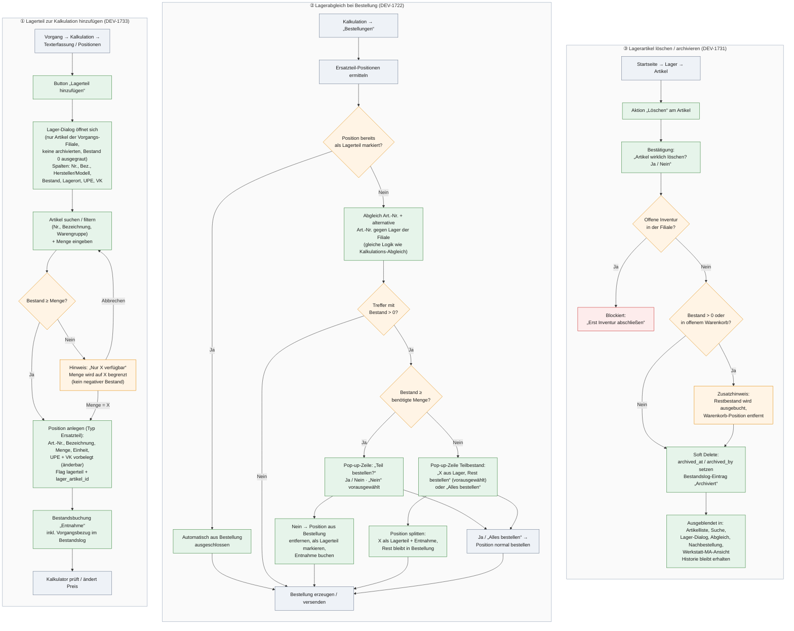

# Lagermodul – Developer Briefing

**Epic:** [DEV-1722](https://pdr-cloud.atlassian.net/browse/DEV-1722) · **Idee:** [PCD-162](https://pdr-cloud.atlassian.net/browse/PCD-162) · **Design:** [UIX-50](https://pdr-cloud.atlassian.net/browse/UIX-50)
**Stand:** 17.11.2026 · **Autor:** Tobias Brinster (Product) · **Status:** Bereit für Refinement · **Entscheidungen E1–E5, E7, E9, E11–E14 bestätigt am 17.11.2026**

> **Ziel:** Das Lagermodul in der Haupt-App soll im Werkstattalltag tatsächlich genutzt werden – für Verbrauchsmaterial, Kleinteile und wiederverwendbare Rest-/Gebrauchtteile (z. B. angeschnittene Seitenwände). Dieses Dokument beantwortet die offenen Fragen vorab, damit die Umsetzung ohne Rückfragen starten kann. Wo eine Entscheidung noch formal bestätigt werden muss, steht ein **Vorschlag (Default)**, mit dem du arbeiten kannst.

---

## 1. Scope auf einen Blick

| # | Feature | Ticket | Aufwand (Schätzung) | Priorität |
|---|---------|--------|---------------------|-----------|
| 1 | Lagerteil per Button zur Kalkulation hinzufügen (inkl. UPE-Übernahme) | [DEV-1733](https://pdr-cloud.atlassian.net/browse/DEV-1733) | M–L | 1 |
| 2 | Lagerabgleich auch beim Bestellen (Pop-up „Teil bestellen? Ja/Nein“) inkl. Teilbestand aufteilen | [DEV-1722](https://pdr-cloud.atlassian.net/browse/DEV-1722) (Story fehlt noch) | L | 2 |
| 3 | Lagerartikel löschen/archivieren | [DEV-1731](https://pdr-cloud.atlassian.net/browse/DEV-1731) | S–M | 1 |
| 4 | Wording/Erklärung „Gebindegröße“ | [DEV-1732](https://pdr-cloud.atlassian.net/browse/DEV-1732) | XS | 3 |

**Nicht im Scope:** Räderlager-Lagerort ändern ([DEV-1825](https://pdr-cloud.atlassian.net/browse/DEV-1825) – anderes Modul), Inventur-Logik, Labeldruck, Lieferanten-Schnittstellen.
**Eng verwandt (bitte mitprüfen):** [DEV-1708](https://pdr-cloud.atlassian.net/browse/DEV-1708) – Filial-Zuordnung von Lagerorten greift nicht. Der neue Lager-Dialog (Feature 1) und der Bestell-Abgleich (Feature 2) filtern nach Filiale; wenn der Filialfilter grundsätzlich defekt ist, betrifft das beide Features.

---

## 2. Ist-Zustand (heute)

Quelle: Confluence „PDR.cloud – Lagermodul“ (Support-Doku, A. Meller).

| Bereich | Pfad | Funktion heute |
|---------|------|----------------|
| Einstellungen | Einstellungen → Lager | Warengruppen, Preisgruppen (VK per Aufschlag) |
| Lager-Hauptansicht | Startseite → Lager | Artikel anlegen/bearbeiten, Warenkorb pro Lieferant, Nachbestellung auf Mindestbestand, Inventur, Bestandslog, manuelle Bestandsbuchung |
| Kalkulation | Vorgang → Kalkulation → Texterf./Positionen → **Lager-Button** | **Abgleich** vorhandener Kalkulationspositionen mit Lagerbestand, Kennzeichnung als Lagerteil, Entnahme + Bestandsreduktion |
| Werkstatt-MA | Werkstatt-Mitarbeiter-Ansicht | Entnahme von Verbrauchsmaterial auf Vorgang (Suche oder QR-Scan) |

**Artikel-Stammdaten heute:** Artikelnummer, Einheit (ST/L/KG/M), Art (OEM/OE/IAS/Gebraucht), Warengruppe, Flag „Verbrauchsmaterial“, Hersteller/Modell, EAN, Bezeichnung, Bild, EK, UPE (optional, pro Einheit), VK (fest oder Aufschlag auf UPE), Filialzuordnung, Mindestbestand + Lagerort (pro Filiale), Lieferant, alternative Artikelnummern, Gebindegröße.

**Probleme laut Kunden/CS:**

1. Artikel lassen sich weder löschen noch archivieren → Liste wächst über Jahre, wird unübersichtlich („Lagerleichen“).
2. Lagerabgleich gibt es nur in der Kalkulation, nicht beim Bestellen → Teile werden bestellt, obwohl sie auf Lager liegen.
3. Um ein Lagerteil in eine (freie) Kalkulation zu bekommen, muss es zusätzlich als **Arbeitstext-Vorlage** gepflegt werden → doppelte Pflege, wird deshalb kaum genutzt.
4. „Gebindegröße“ wird von Kunden nicht verstanden.

---

## 3. Glossar (Fachbegriffe)

| Begriff | Bedeutung |
|---------|-----------|
| **Vorgang** | Ein Werkstattauftrag/Schadenfall in PDR.cloud. Hat genau eine Filiale. |
| **Kalkulation** | Kostenaufstellung im Vorgang. Kann aus DAT/Audatex (AX) importiert oder frei in PDR erstellt werden („freie Kalkulation“). |
| **Texterfassung / Positionen** | Bereich der Kalkulation, in dem manuelle Positionen (Arbeit, Ersatzteil, Material) angelegt werden. |
| **Lagerteil** | Kalkulationsposition, die aus dem eigenen Lager bedient wird (nicht bestellt). |
| **Lagerabgleich** | Vergleich der Ersatzteilpositionen (Art.-Nr. + alternative Art.-Nr.) mit dem Lagerbestand. |
| **UPE** | Unverbindliche Preisempfehlung des Herstellers – Basis für den Verkaufspreis. |
| **EK** | Einkaufspreis der Werkstatt – für die Kalkulation meist nicht relevant. |
| **VK / Preis** | Preis, der in der Kalkulation tatsächlich berechnet wird. |
| **Gebindegröße** | Anzahl Einheiten pro Bestelleinheit (Verpackungseinheit). Beispiel: 12 = ein Karton mit 12 Flaschen. |
| **Verbrauchsmaterial** | Artikel, die Werkstatt-MA selbst auf einen Vorgang ausbuchen dürfen (Clips, Reiniger, Betriebsstoffe). |
| **Inventur** | Abgleich des Systembestands mit dem tatsächlichen Bestand. Solange eine Inventur offen ist, darf sich der Bestand nicht ändern. |

---

## 4. Prozessflow

Gerendert: [`../diagrams/lagermodul_prozessflow.png`](../diagrams/lagermodul_prozessflow.png) / [`.svg`](../diagrams/lagermodul_prozessflow.svg). Grün = neu, grau = existiert schon, orange = Entscheidung/Hinweis, rot = blockiert.



---

## 5. Feature-Spezifikationen

### Feature 1 – Lagerteil zur Kalkulation hinzufügen ([DEV-1733](https://pdr-cloud.atlassian.net/browse/DEV-1733))

**User Story:** Als Kalkulator möchte ich ein Teil direkt aus dem Lager in die Kalkulation übernehmen, damit ich keine Arbeitstext-Vorlage doppelt pflegen muss.

> **Abweichung von PCD-162:** Im Ticket stand „Preis bleibt leer“. Entschieden wurde: **UPE und VK werden vorbelegt**, der Preis bleibt änderbar.

**Ist:** Lagerteile kommen nur über eine zusätzlich gepflegte Arbeitstext-Vorlage in die Kalkulation. Der vorhandene Lager-Button gleicht nur *bestehende* Positionen ab.

**Soll:**

1. In **Texterfassung / Positionen** gibt es einen neuen Button **„Lagerteil hinzufügen“** neben den bestehenden Aktionen (Design: UIX-50).
2. Klick öffnet einen **Lager-Dialog** (Modal), der die Artikelsuche der Lager-Hauptansicht wiederverwendet:
   - Suche nach Artikelnummer, alternativer Artikelnummer, Bezeichnung, EAN
   - Filter nach Warengruppe
   - Spalten (bestätigt): **Art.-Nr., Bezeichnung, Hersteller/Modell, verfügbarer Bestand** (Filiale des Vorgangs, mit Gebinde-Hinweis z. B. „3 Gebinde (= 36 ST)“), **Lagerort, UPE, VK**, Einheit
   - Art (OEM/OE/IAS/Gebraucht) und Bild sind in V1 **nicht** nötig; die Tabelle soll aber erweiterbar sein (Folge-Ticket F1 Restteile)
   - Nur Artikel der **Filiale des Vorgangs** (bzw. ohne Filialzuordnung) und **keine archivierten** Artikel
   - Artikel mit **Bestand 0** werden angezeigt, aber **ausgegraut und nicht wählbar** (Tooltip „Nicht auf Lager – bitte bestellen“)
3. Nutzer wählt **einen oder mehrere** Artikel und gibt je Artikel eine **Menge** ein (Default 1, Dezimal erlaubt bei L/KG/M).
4. Bei **Bestand < Menge**: Hinweis „Nur X {Einheit} verfügbar. Die Menge wird auf X begrenzt. Den Rest bitte über eine Bestellung beschaffen.“ – übernommen wird maximal der vorhandene Bestand (**kein negativer Bestand**, E3). Die Mengeneingabe ist auf den verfügbaren Bestand begrenzt.
5. Pro Artikel wird eine **Ersatzteil-Position** angelegt:

| Kalkulationsfeld | Wert |
|------------------|------|
| Typ | Ersatzteil |
| Teilenummer | Lager-Artikelnummer |
| Bezeichnung | Lager-Artikelbezeichnung |
| Menge | eingegebene Menge |
| Einheit | Lager-Einheit |
| **UPE** | **UPE aus dem Lagerartikel** (pro Einheit) |
| EK | EK aus dem Lagerartikel (falls Feld vorhanden; nur informativ) |
| **Preis** | **VK des Lagerartikels vorbelegt**, änderbar: bei „Fester VK“ der hinterlegte Wert, bei „Aufschlag“ UPE + Aufschlag der Preisgruppe (gleiche Berechnung wie im Lagermodul). Ohne VK bleibt das Feld leer. |
| Lager-Kennzeichen | wie beim bestehenden Abgleich (Position = Lagerteil) |
| Referenz | `lager_artikel_id` (neu, falls nicht vorhanden) |

6. Es wird eine **Entnahme** gebucht (gleiches Verhalten wie der bestehende Abgleich), Bestandslog-Eintrag mit Vorgangsbezug.
7. Wird die Position später **gelöscht** oder die **Menge geändert**, wird die Bestandsbuchung entsprechend **korrigiert** (Rückbuchung/Differenzbuchung mit Log-Eintrag). Eine **Erhöhung** der Menge ist nur bis zum verfügbaren Bestand möglich.

**Akzeptanzkriterien:**

- [ ] Button ist sichtbar in Texterfassung/Positionen, wenn das Lagermodul für den Account aktiv ist; sonst nicht sichtbar.
- [ ] Dialog zeigt nur Artikel der Vorgangs-Filiale + Artikel ohne Filialzuordnung, keine archivierten.
- [ ] Dialog zeigt die Spalten Art.-Nr., Bezeichnung, Hersteller/Modell, Bestand (mit Gebinde-Hinweis), Lagerort, UPE, VK.
- [ ] Artikel mit Bestand 0 sind ausgegraut und nicht wählbar.
- [ ] Menge > Bestand ist nicht möglich; Hinweis erscheint, Menge wird auf den Bestand begrenzt.
- [ ] Nach Übernahme: UPE und Preis (VK) vorbelegt, Preis änderbar, Position als Lagerteil gekennzeichnet.
- [ ] Artikel mit VK per Aufschlag: Preis = UPE + Aufschlag der Preisgruppe, identisch zum Wert in der Lager-Artikelansicht.
- [ ] Artikel ohne VK: Preisfeld leer, kein Fehler.
- [ ] Bestand reduziert sich um die Menge; Bestandslog zeigt „Entnahme – Vorgang {Nr.}“.
- [ ] Position löschen → Bestand wird zurückgebucht, Log-Eintrag „Rückbuchung – Vorgang {Nr.}“.
- [ ] Artikel ohne UPE → UPE-Feld bleibt leer, kein Fehler.
- [ ] Offene Inventur in der Filiale → Hinweis „In dieser Filiale läuft eine Inventur. Bestandsbuchungen können das Inventurergebnis verfälschen.“; Übernahme bleibt möglich (E12).
- [ ] Funktioniert in freier Kalkulation **und** in importierten DAT/AX-Kalkulationen (als manuelle PDR-Zusatzposition; kein Rückschreiben an DAT/AX; bestätigt, E9).
- [ ] Nach erneutem Import/Aktualisierung einer DAT/AX-Kalkulation bleibt die Lager-Zusatzposition erhalten und wird nicht doppelt entnommen.

---

### Feature 2 – Lagerabgleich bei Bestellung ([DEV-1722](https://pdr-cloud.atlassian.net/browse/DEV-1722))

**User Story:** Als Teiledienst/Serviceberater möchte ich beim Bestellen sehen, welche Teile bereits auf Lager liegen, damit ich keine unnötigen Bestellungen auslöse.

**Ist:** Das Pop-up „Teil auf Lager“ erscheint nur beim Abgleich in der Kalkulationsübersicht. Wer direkt über „Bestellungen“ geht, bestellt auch Teile, die vorhanden sind.

**Soll:**

1. Klick auf **„Bestellungen“** aus der Kalkulation startet vor dem Erzeugen der Bestellung den Abgleich.
2. Positionen, die **bereits als Lagerteil gekennzeichnet** sind (über Feature 1 oder den bestehenden Abgleich), werden **automatisch nicht bestellt** und erscheinen nicht im Pop-up.
3. Für alle übrigen Ersatzteil-Positionen: Abgleich Teilenummer gegen Artikelnummer **und** alternative Artikelnummern im Lager der Vorgangs-Filiale. **Die vorhandene Abgleichslogik der Kalkulation wiederverwenden**, nicht neu bauen.
4. Bei Treffern mit Bestand > 0: **Pop-up** (gleiches Layout wie das bestehende Abgleich-Pop-up) mit Liste der Treffer: Teilenummer, Bezeichnung, benötigte Menge, Lagerbestand, Lagerort. Frage je Teil: **„Soll das Teil bestellt werden? Ja / Nein“**. **„Nein“ ist vorausgewählt** (bestätigt, E11) – das Teil wird aus dem Lager genommen, sofern der Nutzer nicht aktiv auf „Ja“ umstellt.
5. **Nein** → Position wird aus der Bestellung entfernt, als Lagerteil gekennzeichnet, Entnahme gebucht (identisch zu Feature 1, Punkt 6).
6. **Ja** → Position wird normal bestellt, keine Bestandsänderung.
6a. **Teilbestand** (0 < Bestand < benötigte Menge, **bestätigt: in diesem Epic**, E4): Die Zeile zeigt „Lager: X / benötigt: Y“ und bietet zwei Optionen:
    - **„X aus Lager, Y−X bestellen“** (vorausgewählt)
    - **„Alles bestellen“**
    „Alles aus Lager“ gibt es nicht, weil der Bestand nicht negativ werden darf (E3).
6b. Bei „X aus Lager, Rest bestellen“ wird die Kalkulationsposition **in zwei Positionen gesplittet**: Position A mit Menge X (Lagerteil, Entnahme gebucht), Position B mit Menge Y−X (wird bestellt). Beide Positionen behalten Teilenummer, Bezeichnung, UPE und Preis pro Einheit; die Summe der Kalkulation ändert sich nicht.
7. Ohne Treffer → kein Pop-up, Bestellung läuft wie heute.

**Akzeptanzkriterien:**

- [ ] Pop-up erscheint nur bei Treffern mit Bestand > 0.
- [ ] „Nein“ ist für jedes Teil vorausgewählt.
- [ ] Ist in der Filiale eine Inventur offen, zeigt das Pop-up zusätzlich den Hinweis aus E12; Buchung bleibt möglich.
- [ ] Bereits gekennzeichnete Lagerteile tauchen weder im Pop-up noch in der Bestellung auf.
- [ ] Treffer über alternative Artikelnummer werden erkannt.
- [ ] „Nein“ reduziert den Bestand und schreibt einen Log-Eintrag mit Vorgangsbezug.
- [ ] Abbrechen des Pop-ups bricht die Bestellung ab (keine Teilbestellung, keine Bestandsänderung).
- [ ] Teilbestand (benötigt 4, Lager 1): Zeile zeigt „Lager: 1 / benötigt: 4“, „1 aus Lager, 3 bestellen“ ist vorausgewählt.
- [ ] Nach Bestätigung: zwei Positionen (1 × Lagerteil, 3 × bestellt), Kalkulationssumme unverändert, Bestand 0, Bestellung enthält 3.
- [ ] „Alles bestellen“ bei Teilbestand: keine Aufteilung, keine Bestandsänderung.
- [ ] Wird eine gesplittete Lager-Position später gelöscht, wird nur deren Menge zurückgebucht.

---

### Feature 3 – Lagerartikel löschen / archivieren ([DEV-1731](https://pdr-cloud.atlassian.net/browse/DEV-1731))

**User Story:** Als Lagerverantwortlicher möchte ich nicht mehr genutzte Artikel entfernen, damit die Liste übersichtlich bleibt.

**Soll:**

1. In der Artikelliste (Startseite → Lager → Artikel) gibt es pro Artikel die Aktion **„Löschen“** (Papierkorb-Icon im Aktionsmenü, siehe UIX-50).
2. Bestätigungsdialog: **„Möchten Sie den Artikel {Art.-Nr. – Bezeichnung} wirklich löschen? Ja / Nein“**
3. Technisch: **Soft Delete / Archivierung** (`archived_at`, `archived_by`), **kein Hard Delete**. Grund: Der Artikel ist über Bestandslog, Kalkulationspositionen, Bestellungen und Rechnungen referenziert; diese Historie muss erhalten bleiben. Das entspricht gängiger Praxis bei Werkstatt- und Inventarsoftware (Soft Delete bei Referenzen, Sperre während offener Inventur).
4. **Prüfungen vor dem Löschen:**

| Bedingung | Verhalten |
|-----------|-----------|
| Offene Inventur in einer Filiale, in der der Artikel geführt wird | **Blockiert**: „Der Artikel ist Teil einer offenen Inventur. Bitte schließen Sie die Inventur zuerst ab.“ |
| Bestand > 0 | Zusatzhinweis im Dialog: „Es sind noch X {Einheit} auf Lager. Der Bestand wird beim Löschen ausgebucht.“ → Ausbuchung mit Log-Eintrag „Archivierung“ |
| Artikel liegt in einem offenen Warenkorb | Zusatzhinweis; Warenkorb-Position wird entfernt |
| Artikel in bereits versendeter Bestellung | Kein Einfluss; Bestellung bleibt unverändert |

5. **Archivierte Artikel werden ausgeblendet in:** Artikelliste (Default), Suche, Lager-Dialog (Feature 1), Abgleich Kalkulation + Bestellung (Feature 2), Nachbestellung, Werkstatt-MA-Ansicht/QR-Scan.
6. **Sichtbar bleiben:** bestehende Kalkulationspositionen, Bestellungen, Rechnungen, Bestandslog.
7. **Filter „Archivierte anzeigen“** in der Artikelliste + Aktion **„Wiederherstellen“** (Bestand startet bei 0).
8. Neuanlage mit derselben Artikelnummer wie ein archivierter Artikel ist erlaubt (Unique-Constraint, falls vorhanden, auf aktive Artikel beschränken) – siehe E6.

**Akzeptanzkriterien:**

- [ ] Löschen nur mit Bestätigung.
- [ ] Archivierter Artikel erscheint in keiner Auswahl/Suche/Nachbestellung mehr.
- [ ] Historische Belege mit dem Artikel bleiben vollständig lesbar.
- [ ] Während offener Inventur ist Löschen blockiert.
- [ ] Wiederherstellen macht den Artikel wieder normal verfügbar.
- [ ] Berechtigung: gleiche Rolle wie „Artikel bearbeiten“ – gilt für Archivieren **und** Wiederherstellen (bestätigt, E7).

---

### Feature 4 – Wording „Gebindegröße“ ([DEV-1732](https://pdr-cloud.atlassian.net/browse/DEV-1732))

**Soll:** Info-Icon (ⓘ) mit Tooltip neben dem Feld „Gebindegröße“ in „Neuer Artikel“ / „Artikel bearbeiten“, zusätzlich eine Hilfezeile unter dem Feld.

**Bestätigte Logik (E13):** Der Lagerbestand wird **in Gebinden** geführt. Wareneingang „1“ = Bestand +1 (= 1 Karton mit 12 Flaschen). Es wird **nicht** mit der Gebindegröße multipliziert.

**Feldlabel:** `Gebindegröße (Inhalt pro Gebinde)`

**Tooltip-Text (final):**
> Wie viele Einzelteile in **einem** Gebinde (Karton, Packung, Kanister) enthalten sind.
> Beispiel: Gebindegröße **12** → 1 Gebinde = 1 Karton mit **12 Flaschen** Reiniger.
> Bestand, Bestellung und Wareneingang werden **in Gebinden** gezählt: Bestellen Sie 1, erhalten Sie 1 Karton (12 Flaschen) und Ihr Bestand erhöht sich um 1.

**Platzhalter im Feld:** `z. B. 12`

**Anzeige-Ergänzung:** Überall, wo Bestand oder Menge eines Artikels mit Gebindegröße > 1 angezeigt wird (Artikelliste, Lager-Dialog, Bestell-Pop-up, Warenkorb), zusätzlich den Inhalt anzeigen, z. B. **„3 Gebinde (= 36 ST)“**. So ist für jeden klar, was gemeint ist.

**Bitte im Code prüfen:** Entspricht das heutige Verhalten beim Wareneingang/in der Nachbestellung dieser Logik (keine Multiplikation)? Falls der Code heute multipliziert, bitte als Befund im Ticket melden, bevor etwas geändert wird – sonst ändern sich Bestände bestehender Kunden.

**Folge zu beachten:** Werkstatt-MA, die einzelne Flaschen entnehmen, buchen Bruchteile eines Gebindes (1 Flasche = 0,083). Siehe Risiko in Abschnitt 8.

---

## 6. Datenmodell – Vorschlag

> Die tatsächlichen Tabellen- und Feldnamen kenne ich nicht. Bitte auf die bestehenden Strukturen mappen; neue Felder nur dort, wo nichts Passendes existiert.

```text
lager_artikel
  + archived_at        TIMESTAMP NULL      -- Soft Delete
  + archived_by        USER_ID   NULL
  (Unique Art.-Nr. nur WHERE archived_at IS NULL)

kalkulation_position
  + lager_artikel_id   FK NULL            -- Referenz auf Lagerartikel
    ist_lagerteil      BOOL               -- vermutlich vorhanden (bestehender Abgleich)

bestandslog
    typ                ENUM  + 'RUECKBUCHUNG', 'ARCHIVIERUNG'
    vorgang_id         FK NULL            -- vermutlich vorhanden
```

Alle Abfragen für Auswahl, Suche, Abgleich, Nachbestellung und Werkstatt-MA brauchen den Filter `archived_at IS NULL`. Am besten zentral als Default-Scope oder Repository-Filter umsetzen, nicht an jeder Stelle einzeln.

---

## 7. Entscheidungen

Mit ✅ markierte Entscheidungen sind von Product bestätigt (17.11.2026). E6, E8 und E10 sind Defaults, mit denen du arbeiten kannst. Ändert sich etwas, wird es hier aktualisiert.

| # | Frage | Entscheidung (Default) | Begründung |
|---|-------|------------------------|------------|
| E1 ✅ | Löschen = Hard oder Soft Delete? | **Bestätigt: Soft Delete** (Archivierung). In der UI heißt die Aktion „Löschen“. | Referenzen in Belegen/Log, Wiederherstellbarkeit |
| E2 ✅ | Wann wird Bestand bei Feature 1 reduziert? | **Bestätigt: sofort beim Übernehmen** in die Kalkulation; Rückbuchung beim Löschen/Ändern der Position | Konsistent zum bestehenden Abgleich |
| E3 ✅ | Darf Bestand negativ werden? | **Bestätigt: Nein.** Bestand wird auf 0 begrenzt; Übernahme/Entnahme nur bis zum verfügbaren Bestand. Gilt für Feature 1, Feature 2 und Werkstatt-MA-Entnahme. | Bestand bleibt verlässlich |
| E4 ✅ | Teilbestand bei Bestellung (benötigt 4, Lager 1)? | **Bestätigt: in diesem Epic.** Optionen „X aus Lager, Rest bestellen“ (vorausgewählt) oder „Alles bestellen“; Umsetzung per Positions-Split. | Vollständiger Nutzen ab Version 1 |
| E5 ✅ | Preis bei Übernahme aus dem Lager? | **Bestätigt: UPE + VK vorbelegen**, Preis bleibt änderbar. VK = fester VK oder UPE + Aufschlag der Preisgruppe; ohne VK bleibt der Preis leer. | Spart Eingaben; Kalkulator behält die Kontrolle |
| E6 | Gleiche Art.-Nr. nach Archivierung neu anlegen? | **Erlaubt** | Typischer Fall: Artikel versehentlich gelöscht oder neu gelistet |
| E7 ✅ | Wer darf löschen und wiederherstellen? | **Bestätigt:** gleiche Berechtigung wie „Artikel bearbeiten“ | Keine neue Rolle nötig |
| E8 | Filialen ohne Filialfunktion? | Filter entfällt; alle aktiven Artikel sichtbar | Abwärtskompatibel |
| E9 ✅ | DAT/AX-importierte Kalkulation? | Button verfügbar; Lagerteil wird als manuelle PDR-Position ergänzt, nicht an DAT/AX zurückgeschrieben | Kein Eingriff in Schnittstellen |
| E10 | Mehrfachauswahl im Lager-Dialog? | **Ja** | Typisch: mehrere Kleinteile/Clips auf einmal |
| E11 ✅ | Vorauswahl im Bestell-Pop-up? | **Bestätigt: „Nein“ (nicht bestellen) vorausgewählt** | Verhindert unnötige Bestellungen am zuverlässigsten |
| E12 ✅ | Entnahme/Übernahme während offener Inventur? | **Bestätigt: nur warnen**, Buchung bleibt möglich. Gilt für Feature 1, Feature 2 und Werkstatt-MA-Entnahme. Löschen (Feature 3) bleibt gesperrt. | Werkstattbetrieb darf nicht blockiert werden |
| E13 ✅ | Gebindegröße beim Wareneingang? | **Bestätigt: Bestand in Gebinden**, Wareneingang 1 = Bestand +1, keine Multiplikation | Bestellung und Bestand nutzen dieselbe Einheit |
| E14 ✅ | Spalten im Lager-Dialog? | **Bestätigt:** Art.-Nr., Bezeichnung, Hersteller/Modell, Bestand (mit Gebinde-Hinweis), Lagerort, UPE, VK, Einheit | Alles, was für die Auswahl und den Preis nötig ist |

---

## 8. Abhängigkeiten & Risiken

- **DEV-1708 (Filialfilter Lagerort):** Wenn die Filialzuordnung grundsätzlich nicht greift, zeigen der neue Dialog und der Bestell-Abgleich Artikel anderer Filialen. → Vor Feature 1/2 klären, ob DEV-1708 nur den Wareneingang betrifft oder die Filiallogik allgemein.
- **Offene Inventur:** Laut Doku führen Bestandsänderungen während einer offenen Inventur zu Fehlern. Bei Feature 1/2 (Entnahme) mindestens **Warnhinweis** anzeigen, wenn für die Filiale eine Inventur offen ist. Sperren ist nicht nötig, das würde den Werkstattbetrieb blockieren. **Bestätigt (E12).**
- **Kein negativer Bestand (E3) – Gleichzeitigkeit:** Zwei Nutzer entnehmen gleichzeitig das letzte Teil. Die Prüfung „Bestand ≥ Menge“ muss **serverseitig und atomar** beim Buchen erfolgen (z. B. bedingtes Update / Row-Lock), nicht nur im Frontend. Schlägt sie fehl: Meldung „Bestand hat sich geändert – nur noch X verfügbar“.
- **Bestehende negative Bestände:** Kunden können heute schon negative Bestände haben. Diese **nicht automatisch ändern**; sie verhindern einfach weitere Entnahmen, bis per Bestandskorrektur oder Inventur ausgeglichen wird. Bitte vor Release per Query prüfen, wie viele Artikel betroffen sind, und CS informieren.
- **Manuelle Bestandskorrektur:** Bleibt für Lagerverantwortliche möglich, darf den Bestand aber ebenfalls nicht unter 0 setzen.
- **Werkstatt-MA mit Gebinden:** Durch E3 kann ein Werkstatt-MA keine Flasche mehr entnehmen, wenn der Bestand 0 ist – auch wenn physisch noch etwas da ist. Das ist gewollt und macht Bestandsfehler sichtbar; CS sollte Kunden darauf hinweisen.
- **DAT/AX-Re-Import (E9):** Prüfen, ob manuelle PDR-Zusatzpositionen bei erneutem Import/Aktualisierung einer DAT/AX-Kalkulation erhalten bleiben. Falls nicht: vor Umsetzung melden – sonst gehen Lagerteile samt Bestandsbuchung verloren.
- **Positions-Split (E4):** Prüfen, wie Rechnung, Auftragsübersicht und Teile-Status mit zwei Positionen derselben Teilenummer umgehen (Anzeige, Summen, Wareneingang).
- **Doppelbuchung:** Wird eine Position erst über Feature 1 hinzugefügt und dann zusätzlich über den alten Abgleich-Button abgeglichen, darf nicht doppelt entnommen werden. → `ist_lagerteil = true` muss den Abgleich überspringen.
- **Bestand in Gebinden (E13):** Bei Verbrauchsmaterial mit Gebindegröße > 1 entnehmen Werkstatt-MA einzelne Stücke → Bestand wird zum Bruchteil (z. B. 0,917 Gebinde). Durch E3 darf er dabei nicht unter 0 fallen. Bitte prüfen, ob Mengenfelder und Bestand Dezimalwerte mit ausreichend Nachkommastellen speichern und anzeigen. Falls das Probleme macht, im Refinement besprechen (Option: Entnahme-Dialog rechnet „1 ST“ automatisch in 1/12 Gebinde um).
- **Abgleichslogik zentralisieren:** Kalkulations-Abgleich und Bestell-Abgleich nutzen dieselbe Funktion (Art.-Nr. + alternative Nr., Filiale, nicht archiviert).

---

## 9. Testfälle (Definition of Done)

| # | Szenario | Erwartung |
|---|----------|-----------|
| T1 | Lagerteil (Bestand 5) mit Menge 2 in freie Kalkulation übernehmen | Position mit UPE und vorbelegtem VK; Bestand 3; Log „Entnahme – Vorgang X“ |
| T2 | Position aus T1 löschen | Bestand 5; Log „Rückbuchung“ |
| T3 | Menge in T1 von 2 auf 3 ändern | Bestand 2; Differenzbuchung |
| T4 | Menge 4 bei Bestand 1 übernehmen | Hinweis „Nur 1 verfügbar“; Menge wird auf 1 begrenzt; Bestand 0 |
| T5 | Bestellung aus Kalkulation mit 1 Lagertreffer → „Nein“ | Teil nicht in Bestellung; als Lagerteil markiert; Bestand reduziert |
| T6 | Bestellung mit Treffer über alternative Art.-Nr. | Treffer im Pop-up |
| T7 | Bestellung mit bereits markiertem Lagerteil | Kein Pop-up für dieses Teil; nicht bestellt |
| T8 | Pop-up abbrechen | Keine Bestellung, keine Bestandsänderung |
| T9 | Artikel mit Bestand 0 löschen | Archiviert, aus allen Listen verschwunden, Historie sichtbar |
| T10 | Artikel mit Bestand 3 löschen | Hinweis, Ausbuchung, Log „Archivierung“ |
| T11 | Artikel löschen bei offener Inventur | Blockiert mit Meldung |
| T12 | Archivierten Artikel wiederherstellen | Wieder auswählbar, Bestand 0 |
| T13 | Filiale A: Artikel nur Filiale B | Nicht im Dialog/Abgleich (abhängig von DEV-1708) |
| T14 | Tooltip Gebindegröße | Text wie in Abschnitt 5, Feature 4 |
| T14a | Wareneingang 1 bei Gebindegröße 12 | Bestand +1; Anzeige „1 Gebinde (= 12 ST)“ |
| T15 | Lagermodul für Account deaktiviert | Kein Button, kein Pop-up |
| T16 | Artikel mit VK per Aufschlag (UPE 100 €, Aufschlag 20 %) übernehmen | Preis 120 € vorbelegt, änderbar |
| T17 | Artikel ohne UPE und ohne VK übernehmen | UPE und Preis leer, kein Fehler |
| T18 | Bestell-Pop-up mit 2 Lagertreffern öffnen | Beide Zeilen „Nein“ vorausgewählt |
| T19 | Lagerteil übernehmen bei offener Inventur | Hinweis erscheint, Übernahme und Entnahme funktionieren |
| T20 | Bestellung: benötigt 4, Lager 1 → „1 aus Lager, 3 bestellen“ | 2 Positionen; Bestand 0; Bestellung über 3; Kalkulationssumme unverändert |
| T21 | Bestellung: benötigt 4, Lager 1 → „Alles bestellen“ | 1 Position, Bestellung über 4, Bestand 1 |
| T22 | Lager-Dialog: Artikel mit Bestand 0 | Ausgegraut, nicht wählbar |
| T23 | Zwei Nutzer übernehmen gleichzeitig das letzte Teil | Nur eine Buchung gelingt; zweiter Nutzer erhält Meldung, Bestand 0 |
| T24 | Werkstatt-MA entnimmt bei Bestand 0 | Entnahme nicht möglich, Hinweis |
| T25 | DAT-Kalkulation mit Lager-Zusatzposition erneut importieren | Zusatzposition und Bestandsbuchung bleiben unverändert |

---

## 10. Ausblick – Folge-Tickets (nicht Teil dieses Epics)

Diese Ideen sind von Product gewünscht und sollen **bei der Umsetzung mitgedacht** werden (Datenmodell und Komponenten so bauen, dass sie später ohne Umbau möglich sind). Für jede wird ein eigenes Ticket angelegt.

### F1 – Rest- und Gebrauchtteile einlagern

**Problem:** Bei Karosserieteilen (z. B. Seitenwand, Seitenrahmen) wird oft nur ein Teil verbaut. Der Rest ist nicht mehr retournierbar, könnte aber in einem anderen Auftrag genutzt werden.

**Idee:**

- Aus einer Kalkulationsposition oder Bestellung heraus: Aktion „Restteil einlagern“
- Neuer Lagerartikel mit Art = **Gebraucht** (existiert bereits), vorbefüllt mit Teilenummer, Bezeichnung, Hersteller/Modell aus dem Vorgang
- Zusätzliche Felder: **Zustand** (z. B. „angeschnitten – A-Säule fehlt“), **Fotos** (Pflicht, min. 1), **Herkunftsvorgang** (Link)
- Bestand typischerweise 1; Lager-Dialog und Abgleich (Feature 1/2) zeigen Gebrauchtteile mit eigenem Badge „Restteil“ und Foto-Vorschau, damit vor Verwendung geprüft wird

**Mitdenken jetzt:** Lager-Dialog und Abgleich-Pop-up so bauen, dass die Spalten **Art** und **Bild** sowie ein Badge „Restteil“ später ergänzt werden können (in V1 bewusst nicht enthalten, E14).

### F2 – Mindestbestand-Alarm

**Problem:** Nachbestellung auf Mindestbestand muss heute aktiv angestoßen werden.

**Idee:**

- Wenn eine Buchung (Entnahme, Abgleich, Werkstatt-MA) den Bestand **unter den Mindestbestand** (pro Filiale) senkt → Hinweis im Dashboard/Benachrichtigungscenter an Lagerverantwortliche
- Ein Klick: „In den Warenkorb“ mit Menge = Auffüllen auf Mindestbestand (Bestand und Mindestbestand in Gebinden, siehe E13; auf volle Gebinde aufrunden)
- Einstellung: Empfänger (Rolle/Nutzer), an/aus pro Filiale

**Mitdenken jetzt:** Alle Bestandsbuchungen laufen über **eine zentrale Buchungsfunktion**, an der später ein Event „Bestand unter Mindestbestand“ hängen kann.

### F3 – Ladenhüter-Report

**Problem:** Artikel ohne Bewegung blähen die Liste auf und binden Kapital („Lagerleichen“).

**Idee:**

- Report/Filter in der Artikelliste: **„Keine Bewegung seit X Monaten“** (X wählbar: 6/12/24), mit Bestand und Bestandswert (Bestand × EK)
- Mehrfachauswahl → **„Archivieren“** (nutzt Feature 3)
- Optional jährlicher Hinweis vor der Inventur: „N Artikel ohne Bewegung – jetzt prüfen?“

**Mitdenken jetzt:** Bestandslog mit Zeitstempel ist Grundlage; „letzte Bewegung“ sollte performant abfragbar sein (z. B. Feld `last_movement_at` am Artikel, bei jeder Buchung aktualisiert).

---

## 11. Quellen

**Intern**

- [PCD-162 – Idee (Basis)](https://pdr-cloud.atlassian.net/browse/PCD-162)
- [DEV-1722 – Epic](https://pdr-cloud.atlassian.net/browse/DEV-1722) · [DEV-1731](https://pdr-cloud.atlassian.net/browse/DEV-1731) · [DEV-1732](https://pdr-cloud.atlassian.net/browse/DEV-1732) · [DEV-1733](https://pdr-cloud.atlassian.net/browse/DEV-1733) · [UIX-50](https://pdr-cloud.atlassian.net/browse/UIX-50)
- [DEV-1708 – Filialfilter Lagerort](https://pdr-cloud.atlassian.net/browse/DEV-1708) · [DEV-1825 – Räderlager](https://pdr-cloud.atlassian.net/browse/DEV-1825) · [SUP-733 – K&L-Nutzung](https://pdr-cloud.atlassian.net/browse/SUP-733)
- [Confluence: PDR.cloud – Lagermodul (Support-Doku)](https://pdr-cloud.atlassian.net/wiki/spaces/Support/pages/1277558785/PDR.cloud+-+Lagermodul)

**Extern (Best Practice)**

- [Workshop Software – Product deletion & soft delete logic](https://knowledgebase.workshopsoftware.com/how-product-deletion-and-soft-delete-logic-works) – Soft Delete bei Referenzen, Sperre während Inventur
- [IF4IT – Retire inventory entries properly: mark as inactive before removing](https://if4it.org/best-practices/enterprise-inventory-management/retire-inventory-entries-properly-mark-as-inactive-before-removing/)
- [Reftab – When to archive vs. delete assets](https://www.reftab.com/blog/when-to-archive-vs-delete-assets-itam-best-practices)
- [AppMaster – Soft delete vs hard delete](https://appmaster.io/blog/soft-delete-vs-hard-delete)
- [AUTOHAUS – Lagerleichen ade](https://www.autohaus.de/nachrichten/autohandel/lagerleichen-ade-1270878) – Problem nicht abgeholter/ungenutzter Teile im Werkstattlager
- [tacto – Gebindegrößen (Einkäufer-Lexikon)](https://www.tacto.ai/de/einkaufer-lexikon/gebindegroessen)
